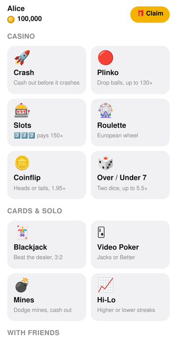
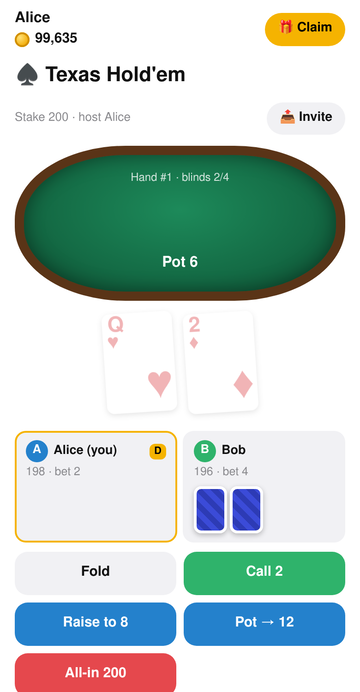
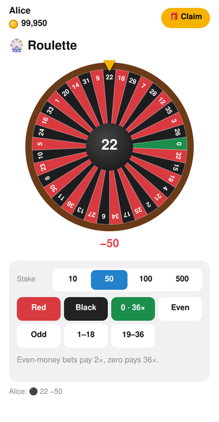
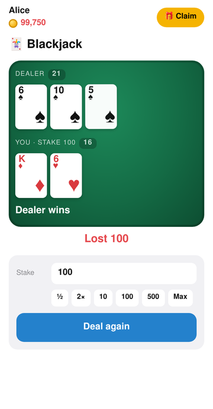
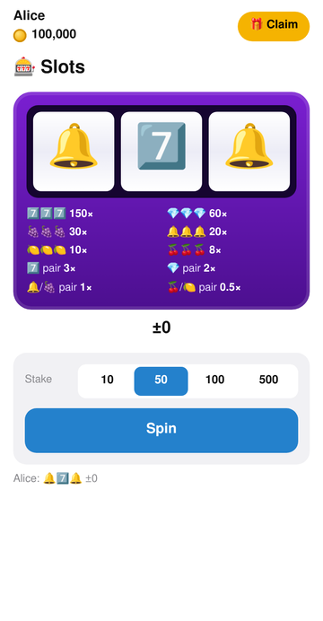
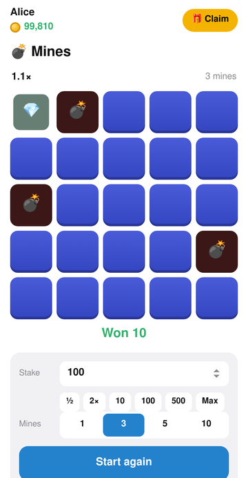
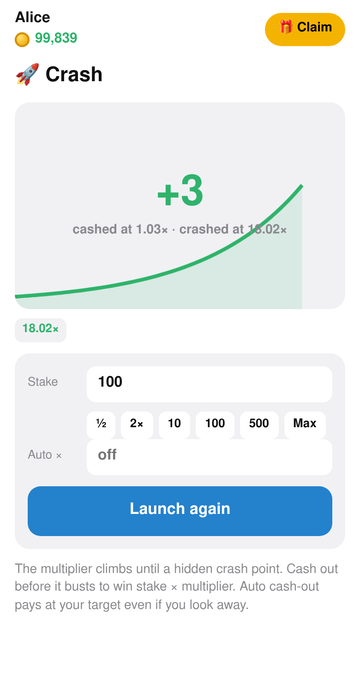
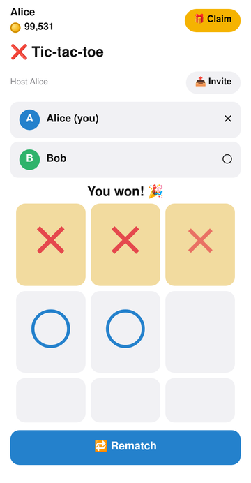

<p align="center">
  
</p>

<h1 align="center">Telegram Games</h1>

<p align="center">
  Casino, poker, Persian card and party games for Telegram: chat games, inline mode and a graphic Mini App. Play chips only, never cashed out.<br>
  Runs serverless on <a href="https://core.telegram.org/bots/serverless">Telegram Serverless (tgcloud)</a>, Telegram's platform for bots. The bot's code, the database and the Mini App are all hosted by Telegram.
</p>

<p align="center">
  <a href="https://t.me/chthgamesbot">Try it: @chthgamesbot</a> · <a href="LICENSE">MIT License</a>
</p>

---

- **22 games:** Texas Hold'em, Hokm (حکم), Shelem (شلم), video poker, blackjack, slots, roulette,
  crash, plinko, mines, duels, trivia, hangman and more.
- **Three ways to play:**
  - in any chat, with inline keyboards
  - in chats the bot isn't in, through inline mode
  - in a full graphic **Mini App**
- **The same rules everywhere.** The Mini App drives the same game modules as the chat
  buttons, so rules and chip handling can't drift apart.
- **Play chips only.** Chips are free (a start balance and a daily bonus) and can be bought with
  Telegram Stars, but they can never be sold, transferred or cashed out.

<p align="center">
  
  
  
  
</p>
<p align="center">
  
  
  
  
</p>

## Features

### Games

| Group | Games | Inline mode (`@yourbot …`) |
|---|---|---|
| 🎰 Casino tables: one shared message anyone can play | Slots, Roulette, Coinflip, Over/Under 7 | `slots` `roulette` `coinflip` `dice` |
| 🃏 Solo vs the house | Blackjack, Video Poker (Jacks or Better), Mines, Hi-Lo | `blackjack` `videopoker` `mines` `hilo` `[stake]` |
| ♠️ Poker | Texas Hold'em, no-limit cash table, 2–8 players | `poker [buy-in]` |
| ⚔️ Bet with friends | Coinflip Duel, Dice Duel, Rock-Paper-Scissors, Jackpot, Russian Roulette | `flipduel` `diceduel` `rps` `jackpot` `roulette6` `[stake]` |
| 🇮🇷 Persian card games: 4 players, two teams | Hokm (حکم), Shelem (شلم) | `hokm` `shelem` `[stake]` |
| 🎉 Party (free) | Tic-tac-toe, Connect Four, Trivia, Hangman | `tictactoe` `connect4` `trivia` `hangman` |
| 📱 Mini App only | Crash, Plinko | 🕹 Game hub button or the 🎮 Play menu button |

**Mini App and inline mode:**
- Every game is also in the Mini App with real graphics: cards, dice, a spinning wheel,
  reels and a poker table.
- Multiplayer games in the app use rooms that you share with an invite link.
- In any chat, type `@yourbot [game] [stake]` to drop a game lobby in.

**In the private chat everything is a button** ([shared style](../README.md#how-they-work)), in English, Persian, Arabic, Russian or Spanish
(the player's Telegram language, or 🌐 Language): 🎮 Games · 🕹 Game hub · 💰 Balance ·
🎁 Daily chips (a free bonus every 20 hours) · 💎 Buy chips · 🏆 Top players · 🌐 Language · ℹ️ About (🔗 Source code, ⭐ Tip the developer).
Button taps are deleted and each menu replaces the previous one; game messages stay. In groups,
send `/start@yourbot` (or add the bot) for the games menu, or use inline mode. `/start`,
`/paysupport` and the admin commands are the only slash commands. Game messages are written in the language of whoever
started them; the Mini App is English.

### Hokm and Shelem

Both are partnership trick-taking games for four. Partners sit opposite: the 1st and 3rd to
join play the 2nd and 4th, and the game deals when the 4th player joins. You must follow the
led suit if you can; the highest trump, else the highest card of the led suit, takes the trick.
Everyone pays the stake on joining and each player on the winning team gets 2× back.

- **Hokm (حکم).** Cards are dealt until someone gets an ace: they are the first Hakem. The
  Hakem calls trump from their first five cards, then everyone gets 13. The first team to 7
  tricks takes the hand: 1 point, 2 for a 7–0 kot, 3 if the kot is against the Hakem. The Hakem
  keeps the role while their team wins; otherwise it passes to the next player. First to 7
  points wins.
- **Shelem (شلم).** 12 cards each and 4 in the kitty. Bids start at 100 and go up in fives to
  165 (shelem); a pass is final. The top bidder takes the kitty, puts down 4 cards, calls trump
  and leads. Tricks are worth 5, aces and tens 10, fives 5: 165 a hand, with the put-down cards
  counting as one more trick for the bidder. Making the bid scores what the team took (a made
  shelem scores 330); missing it scores minus the bid. The other team keeps what it took. First
  team to 500 wins; a team that sinks to −500 loses.

Hands are private. In chat, 👀 My hand opens a popup only you see, with numbered cards
(①②③…), and you play by tapping that number. The number buttons are the same for everyone, so
they give nothing away. In the Mini App you tap the card itself, and only legal cards can be
tapped. If the player to act is idle for 10 minutes, the other team can claim the win.

### 💎 Buy chips (Telegram Stars)

Players can buy chip packs with [Telegram Stars](https://core.telegram.org/bots/payments-stars)
from 💎 Buy chips in the private chat, or from the 💎 button in the Mini App. Buying is one way
only: chips can't be sold, sent to other players or cashed out, so the bot never owes anyone
money. The packs are in `PACKS` in `tgcloud/lib/config.js`.

How a purchase works:
1. Each pack is a reusable invoice link (`createInvoiceLink`, currency `XTR`).
2. `handlers/pre_checkout_query.js` checks the pack, the amount and the player.
3. The `successful_payment` message credits the chips once per `telegram_payment_charge_id`,
   which is stored in the `purchases` table.
4. A refund (`/refund`, or Telegram's `refunded_payment`) takes the chips back, down to zero.

`/paysupport` is the payment-support command Telegram asks for: it lists the player's recent
payments and forwards their message to the admins. Run `npm run migrate` after updating, to
create the `purchases` table. You collect Stars as the bot's owner; Telegram's
[Stars terms](https://telegram.org/tos/stars) apply.

### Fairness

Every house game returns less than 100%, and `npm test` checks this exactly:

| Game | Return to player |
|---|---|
| Slots | 97.6% |
| Roulette | 97.3% |
| Plinko | about 97% |
| Crash, Mines, Hi-Lo | 97% |
| Video poker (8/5 Jacks or Better) | 97.3% with perfect play (published figure) |

All randomness comes from `crypto.getRandomValues` on the server. The client only animates
results the server has already decided.

## Admins

The ids in `ADMIN_IDS` get these commands in their own command menu; `/admin` lists them.

| Command | What it does |
|---|---|
| `/stats` | Players, chips in circulation, activity |
| `/user <id>` | Player details (or reply to their message) |
| `/grant <id> <±amount>` · `/setchips <id> <amount>` | Change a player's chips |
| `/resetdaily <id>` | Make the daily bonus claimable now |
| `/ban <id>` · `/unban <id>` | A banned player is blocked in chat, inline mode and the Mini App |
| `/broadcast <text>` | Sends to 40 players per run; add `from=<id>` to continue |
| `/payments [id]` | The latest Stars purchases, for everyone or one player |
| `/refund <charge id>` | Returns the Stars and takes the chips back |

## Run your own

You need Node.js 18+ and a bot from [@BotFather](https://t.me/BotFather).

1. **Turn on Serverless.** In @BotFather, open your bot → Serverless → enable. Then copy the
   **CLI access token** (`app<id>:<secret>`). This is not the bot token.
2. **Clone and install:**
   ```sh
   git clone https://github.com/chethober/bots && cd bots/chthgamesbot
   npm install
   cp secrets.example.js tgcloud/lib/secrets.js   # set BUTTON_SECRET and ADMIN_IDS
   ```
3. **Point the config at your bot:** set `BOT_USERNAME` in `tgcloud/lib/config.js`.
4. **Deploy:**
   ```sh
   npx tgcloud login           # paste the CLI token
   npm run deploy              # prints your Mini App URL
   npm run migrate             # creates the tables
   ```
   Put the printed URL in `WEBAPP_URL` in `tgcloud/lib/config.js`, then run `npm run deploy` again.
5. **Set up the profile:** the name, descriptions, command menus, 🎮 Play menu button and
   avatar. The command in the header of `scripts/setup.js` runs it once without deploying it.
6. **Finish in @BotFather:**
   - `/setinline` to enable inline mode
   - Bot Settings → Configure Mini App, using your app URL
   - Leave group privacy on. Bots still receive `/command@yourbot` in groups.

After updating, run `npm run migrate` (new player columns).

The npm scripts set `NODE_USE_ENV_PROXY=1`, so the CLI uses `https_proxy` when you have one set.

## Tests

```sh
npm test                 # rules, Telegram limits, house edge, poker, hidden-state leaks, fuzzing
npm run test:ui          # every Mini App screen in headless Chromium, with two players
UI_BASE=https://app<id>.tgcloud.ai/ npm run test:live-ui   # same, against your deployed site
```

The UI tests use `playwright-core`. Either install its browser with
`npx playwright-core install chromium-headless-shell`, or set `CHROME_PATH`. Add `-- --shots`
to save screenshots to `test/shots/`.

## How it works

```
tgcloud/
├── schema.js              players (wallet + stats), sessions (all game state), purchases (Stars), games (legacy)
├── handlers/              message (commands, payments) · callback_query (every button) · inline_query · pre_checkout_query
├── endpoints/             play (every game, for the Mini App) · wallet · shop · crash · plinko
└── lib/
    ├── engine.js          wallet, versioned session storage, message edits, the game `ctx`
    ├── games/*.js         one pure module per game, plus factories (table, solo, duel, pot, board, tricks)
    ├── shop.js            Telegram Stars packs: invoices, crediting, refunds
    ├── poker.js           hand evaluator, video poker pay table
    └── admin.js           /admin commands
public/                    the Mini App: plain ES modules, no build step
├── js/app.js              shell: wallet, home, navigation, rooms
├── js/kit.js              shared UI: cards, dice, stake picker, lobby buttons
└── js/games/*.js          one screen per game
test/
├── validate.js            rules, limits, house edge, leaks, chip conservation (no network)
└── ui.js                  headless-browser run through every Mini App screen
scripts/setup.js           one-off bot profile setup (name, description, commands, avatar)
```

**Game modules are pure.** They never import the SDK. They talk to the platform through a
small `ctx` object: session, create, mutate, debit, credit, refund, edit and answer.
- The chat handler builds one `ctx`, where `edit` updates the Telegram message.
- The Mini App's `play` endpoint builds another, where the app re-reads the game's state.
- The tests build a third, in memory.

**Money safety:**
- Stakes are taken with a conditional `chips >= stake` update.
- Every state change is a version-checked write, retried on conflict.
- A payout happens only on the write that ended the game, so double taps, retries and two
  devices can't pay twice.
- Lobby buttons are HMAC-signed, so a modified client can't forge who created a game or
  what the stake is.
- Handlers never throw, so Telegram never redelivers an update that already moved chips.
- If a chip game sits idle for 10 minutes, the other players can call it off, so an AFK
  player can't lock everyone's stake.

**Hidden information.** State reaches the Mini App only through each game's
`view(state, viewer)`. The views hide:
- decks, mines and the bullet
- trivia answers and the hangman word
- an opponent's rock-paper-scissors pick
- Hold'em hole cards, until showdown
- Hokm and Shelem hands, and the Shelem kitty

The tests fuzz every game and fail if any of these leak. In chat, Hold'em hole cards are
shown only in a private "👀 My cards" popup, and Hokm and Shelem hands in "👀 My hand".

See [`AGENTS.md`](AGENTS.md) for the platform's module rules and [`docs/tgcloud-sdk.md`](docs/tgcloud-sdk.md) for the SDK reference.

## Contributing

Issues and pull requests are welcome; see [CONTRIBUTING.md](CONTRIBUTING.md). Run `npm test` before sending a change.

## License

[MIT](LICENSE) © chethober.

`AGENTS.md` and `docs/tgcloud-sdk.md` come from the `@tgcloud/cli` project template
(MIT, © Telegram Messenger).

This project is for entertainment with play chips. Chips can be bought but never cashed out.
Don't adapt it for real-money gambling: cash-outs make it gambling under most countries' laws
and against Telegram's terms.
